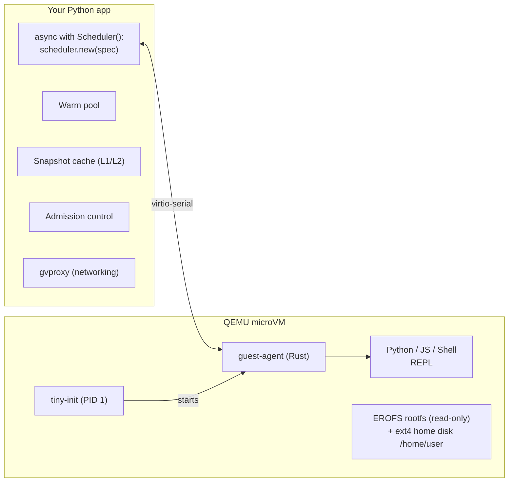

# exec-sandbox

[](https://github.com/dualeai/exec-sandbox/actions/workflows/test.yml)
[](https://codspeed.io/dualeai/exec-sandbox?utm_source=badge)
[](https://codecov.io/gh/dualeai/exec-sandbox)
[](https://pypi.org/project/exec-sandbox/)
[](https://pypi.org/project/exec-sandbox/)
[](https://opensource.org/licenses/Apache-2.0)

exec-sandbox runs untrusted code in QEMU microVMs on your own Linux or macOS hosts. It is a Python asyncio library with a command line (`sbx`), made for AI agents that write and run Python, JavaScript or shell code. No cloud account, no API key, no per-run fees.

```python
import asyncio

from exec_sandbox import Scheduler, VmSpec


async def main() -> None:
    async with Scheduler() as scheduler:
        async with await scheduler.new(VmSpec(language="python")) as session:  # or "javascript", "raw"
            result = await session.exec("print('Hello from a secure VM!')")
            print(result.stdout)  # Hello from a secure VM!
            print(result.exit_code)  # 0


asyncio.run(main())
```

Put the other Python examples in an `async def` function like `main()` above: they use `async with` and `await` at the top level.

## Contents

- **Start:** [Why exec-sandbox](#why-exec-sandbox) · [Install](#install) · [Quick start](#quick-start) · [Key terms](#key-terms)
- **Use:** [Sessions](#sessions) · [Files](#files) · [Packages](#packages) · [Network](#network) · [Saved instances](#saved-instances) · [Configuration](#configuration) · [Errors and recovery](#errors-and-recovery)
- **Operate:** [Performance](#performance) · [Caches and disk use](#caches-and-disk-use) · [VM images and offline use](#vm-images-and-offline-use) · [Linux host setup](#linux-host-setup)
- **Reference:** [CLI reference](#cli-reference) · [API reference](#api-reference) · [Limits](#limits) · [Guest environment](#guest-environment)
- **Internals:** [How it works](#how-it-works) · [Security](#security) · [Contributing](#contributing) · [License](#license)

## Why exec-sandbox

### Highlights

- **Hardware isolation** — Each session runs in its own VM (QEMU with KVM or HVF hardware acceleration), not in a container, behind up to 8 layers of isolation, from a custom hardened kernel to socket-level process authentication (some layers need Linux and host setup: see [Security](#security)).
- **1-2 ms start from the warm pool** — VMs started before the request. About 100 ms from an L1 memory snapshot (QEMU 11.0 or later) for a spec that ran before. A cold boot takes about 400 ms, plus 4-11 s for the interpreter to start ([Snapshot cache](#snapshot-cache)).
- **Self-hosted** — The first use downloads the VM images from GitHub Releases (`sbx prefetch` for offline hosts).
- **Python API and CLI** — `scheduler.new(spec)` returns a session: run code once or in several steps, and read and write files. The `sbx` command does the same from a terminal.
- **Saved instances** — `save()` writes the RAM, the processes and `/home/user` of a VM to S3 or a local folder, encrypted with AES-256-GCM. `reuse()` continues it later, on any worker of the same host kind.
- **3-tier snapshot cache** — L1 memory snapshots, L2 disk snapshots (packages installed), and the L3 snapshot cache in S3, shared by all hosts.
- **Network control** — No network access by default. Turn it on per spec, with a list of allowed domains, checked by DNS filtering and TLS SNI inspection.
- **Streaming output** — Get stdout and stderr while the code runs.
- **Memory optimization** — zram compression in the guest; on Linux, KSM page merging and memory reclaim of idle warm-pool VMs.

## Install

### Requirements

| Requirement | Supported |
|-------------|-----------|
| Python | 3.12, 3.13, 3.14 (including free-threaded) |
| Linux | x64, arm64 |
| macOS | x64, arm64 |
| Windows | Not supported (`import exec_sandbox` raises `ConfigError` `PLATFORM_UNSUPPORTED`); use WSL2 |
| QEMU | 11.0+ for L1 memory snapshots and saved instances. 8.0+ runs VMs without them. ARM64 without KVM or HVF needs 9.0.4+ |
| Hardware acceleration | KVM (Linux) or HVF (macOS) recommended, ~5-8x faster |

### Install the package

```bash
uv add exec-sandbox              # Core library
uv add "exec-sandbox[cli]"       # + the sbx command line and the local instance store
uv add "exec-sandbox[s3]"        # + the L3 snapshot cache and the s3 instance store
```

The `local` store also works with the `s3` extra alone. To use `sbx` with the `s3` store, install `exec-sandbox[cli,s3]`.

### Install QEMU

```bash
brew install qemu                       # macOS
apt install qemu-system qemu-utils      # Ubuntu/Debian
```

- exec-sandbox runs `/usr/bin/qemu-system-<arch>` (`x86_64` or `aarch64`) when that file exists, else the one on `PATH` (set `EXEC_SANDBOX_QEMU_BIN_X86` or `EXEC_SANDBOX_QEMU_BIN_ARM` to use another file), and `qemu-img` and `qemu-storage-daemon` from `PATH`. A missing one fails with `ConfigError` (`HOST_DEPENDENCY`).
- Check the version of that QEMU binary (for example `/usr/bin/qemu-system-x86_64 --version`): L1 memory snapshots and saved instances need QEMU 11.0 or later ([Requirements](#requirements)). Ubuntu 24.04 ships QEMU 8.2.2.

### Check hardware acceleration

The Linux command prints `ok`; on macOS, `kern.hv_support: 1` means yes:

```bash
test -r /dev/kvm -a -w /dev/kvm && echo ok   # Linux: your user needs read and write access
sysctl kern.hv_support                        # macOS
```

On Linux, give your user access with `sudo usermod -aG kvm $USER`, then log in again. When `/dev/kvm` exists but your user cannot use it, exec-sandbox logs one warning with this fix and uses TCG.

On Linux, to run QEMU as its own user with cgroup limits and namespaces, see [Linux host setup](#linux-host-setup).

## Quick start

### Command line

```bash
# Run Python code
sbx run 'print("Hello from sandbox")'

# Run JavaScript
sbx run -l javascript 'console.log("Hello from sandbox")'

# Run a file (the file extension gives the language)
sbx run script.py
sbx run app.js

# With packages
sbx run -p requests==2.32.5 -p pandas==3.0.1 'import pandas; print(pandas.__version__)'

# Turn on the network, with an allow-list of domains
sbx run --network --allow-domain api.example.com fetch_data.py

# Keep the VM state between runs (see Saved instances)
sbx run --instance my-vm -c 'x = 41'
sbx run --instance my-vm -c 'print(x + 1)'    # 42
```

All options, exit codes and the JSON output: [CLI reference](#cli-reference).

### Python

`scheduler.new(spec)` returns a session: one VM that stays alive across `exec()` calls. Variables, imports and files stay from one call to the next. Closing the session destroys the VM.

```python
from exec_sandbox import Scheduler, VmSpec

async with Scheduler() as scheduler:
    async with await scheduler.new(VmSpec(language="python")) as session:
        await session.exec("import math")
        await session.exec("x = math.pi * 2")
        result = await session.exec("print(f'{x:.4f}')")
        print(result.stdout)  # 6.2832
        print(session.exec_count)  # 3
```

## Key terms

| Term | Meaning |
|------|---------|
| Session | One VM that stays alive across `exec()` calls; `close()` destroys it. See [Sessions](#sessions) |
| Spec | A `VmSpec`: what a VM is made of (language, memory, disk, packages, network, ports). See [VmSpec](#vmspec) |
| REPL | The interpreter process in the VM that runs your code and keeps its state between `exec()` calls |
| Warm pool | VMs started before the request, for the default spec of each language (`warm_pool_size`). See [Warm pool](#warm-pool) |
| L1, L2, L3 | The snapshot cache: L1 memory snapshots, L2 disk snapshots with the packages installed, and the L3 snapshot cache, a copy of L2 in S3. See [Snapshot cache](#snapshot-cache) |
| Saved instance | The state of a VM (RAM, processes, files in `/home/user`) that `save()` writes and `reuse()` continues later. See [Saved instances](#saved-instances) |
| Instance store | Where saved instances live: your S3 bucket (the `s3` store), or a folder on this host (the `local` store). See [Choose a store](#choose-a-store) |
| Generation | The number of a save of an instance: 1 after the first save, +1 for each later save |
| Head | The small object of an instance in the store that names its current state |
| Guest images | The disk images of a VM: the base image and, with packages, the L2 package image. The instance store keeps a copy for saved instances |
| Worker | A process that runs a `Scheduler`. Its host is the machine or container that it runs on |
| Host kind | CPU architecture, accelerator, CPU vendor (x86) and exec-sandbox release. A saved instance loads only on a worker of the same host kind. See [Rules for save and reuse](#rules-for-save-and-reuse) |
| Admission | The wait until the host has the memory, CPU and disk for a VM. See [Limits](#limits) |
| KVM, HVF, TCG | Hardware acceleration on Linux (KVM) and macOS (HVF). TCG is QEMU's software emulation. See [Check hardware acceleration](#check-hardware-acceleration) |

## Sessions

### One VM per session

Each `new()` gives a new VM: keep one session for work that needs state.

Background processes stay alive between the `exec()` calls of a session, up to the process limit of the VM ([Limits](#limits)).

An error can also close a session: see [What closes a session](#what-closes-a-session).

### Languages

Sessions support all three languages:

```python
# JavaScript/TypeScript — variables and functions stay between calls
async with await scheduler.new(VmSpec(language="javascript")) as session:
    await session.exec("const greet = (name: string): string => `Hello, ${name}!`")
    result = await session.exec("console.log(greet('World'))")

# Shell (Bash) — env vars, the working folder and functions stay between calls
async with await scheduler.new(VmSpec(language="raw")) as session:
    await session.exec("cd /tmp && export MY_VAR=hello")
    result = await session.exec("echo $MY_VAR from $(pwd)")
```

### Idle timeout

A session closes itself after a time with no call (the idle timeout: `session_idle_timeout_seconds`, 300 s by default). To set it for one session, pass `idle_timeout_seconds` (10-3600) to `new()` or `reuse()`. A value out of range raises `InvalidInputError` (`ARGUMENT_INVALID`) before any VM starts.

### Stream output

Pass `on_stdout` and `on_stderr` to get the output while the code runs:

```python
async with Scheduler() as scheduler:
    async with await scheduler.new(VmSpec(language="python")) as session:
        result = await session.exec(
            "for i in range(5): print(i)",
            on_stdout=lambda chunk: print(f"[OUT] {chunk}", end=""),
            on_stderr=lambda chunk: print(f"[ERR] {chunk}", end=""),
        )
```

Keep each callback short (also `on_boot_log`): a slow callback blocks the event loop.

### Boot logs

To see the boot output of the kernel, tiny-init and the guest agent, pass `on_boot_log`:

```python
boot_lines: list[str] = []
# on_boot_log turns on verbose boot and always cold boots (no warm pool, no L1)
async with await scheduler.new(VmSpec(language="python"), on_boot_log=boot_lines.append) as session:
    await session.exec("print('hello')")
```

## Files

Paths are relative to `/home/user`, the folder where your code runs.

### From Python

```python
import io
from pathlib import Path
from exec_sandbox import Scheduler, VmSpec

async with Scheduler() as scheduler:
    async with await scheduler.new(VmSpec(language="python")) as session:
        # Write from bytes, a local Path, or any IO[bytes] stream
        await session.write_file("input.csv", b"name,score\nAlice,95\nBob,87")
        await session.write_file("model.pkl", Path("./local_model.pkl"))
        await session.write_file("data.bin", io.BytesIO(b"in-memory"))

        # Run code that reads the input and writes the output
        await session.exec("data = open('input.csv').read().upper()")
        await session.exec("open('output.csv', 'w').write(data)")

        # Read to a local Path (replaced when the read is complete) or any IO[bytes] buffer
        await session.read_file("output.csv", destination=Path("./output.csv"))
        buf = io.BytesIO()
        await session.read_file("data.bin", destination=buf)

        # List the files of a folder
        files = await session.list_files("")  # /home/user
        for f in files:
            print(f"{f.name} {'dir' if f.is_dir else f'{f.size}B'}")
```

`write_file(path, content, make_executable=True)` gives the file mode 0755 (default 0644).

### From the command line

```bash
# Upload a local file, run code, download the result
sbx run --upload ./local.csv:input.csv --download output.csv:./result.csv \
  -c "open('output.csv','w').write(open('input.csv').read().upper())"

# Download to ./output.csv (shorthand, no local path)
sbx run --download output.csv -c "open('output.csv','w').write('data')"
```

## Packages

The first VM of a spec installs the packages and saves an L2 disk snapshot, then an L1 memory snapshot. Later VMs of the same spec start from the L1 memory snapshot in about 100 ms.

```python
DATA = VmSpec(language="python", packages=("pandas==3.0.1",))
JS = VmSpec(language="javascript", packages=("lodash@4.17.21",))

async with Scheduler() as scheduler:
    async with await scheduler.new(DATA) as session:
        result = await session.exec("import pandas; print(pandas.__version__)")
        print(result.stdout)  # 3.0.1
```

Package rules:

- Each package is a name and a version: `pandas==3.0.1` (python), `lodash@4.17.21` (javascript). Other operators (`>=`, `~=`) pass too; `==` gives a stable cache entry. A package without a version, a bad name, or packages for `raw` raise `InvalidInputError` (`ARGUMENT_INVALID`). A package outside the allow-list (the top 10,000 of PyPI or npm) raises `PACKAGE_NOT_ALLOWED`.
- Scoped npm names (`@scope/name`) are refused. Count and size limits: [Limits](#limits).
- Python packages install with `uv pip install --no-build` into Python 3.14 on musl: pure-Python wheels and musllinux wheels work; a package with only a source distribution fails.
- The install VM reaches only PyPI or npm, whatever the network settings of the spec.

The runtimes and tools of each image: [Guest environment](#guest-environment).

## Network

### Outbound access

```python
spec = VmSpec(language="python", allow_network=True, allowed_domains=("httpbin.org",))  # Allow-list of domains

async with Scheduler() as scheduler:
    async with await scheduler.new(spec) as session:
        await session.exec("import urllib.request; print(urllib.request.urlopen('https://httpbin.org/ip').read())")
```

With `allow_network=True`, `allowed_domains` decides what the guest can reach:

- `None` (default): the package registries of the language only (python: `pypi.org`, `files.pythonhosted.org`; javascript: `registry.npmjs.org`). `raw` reaches every host.
- `()` (empty): every host.
- A list of domains: these domains and their subdomains only (`example.com` also allows `api.example.com`).

### Port forwarding

```python
from exec_sandbox import PortMapping, Scheduler, VmSpec

async with Scheduler() as scheduler:
    # Port forwarding without internet (isolated): guest 8080 -> host 3000
    spec = VmSpec(language="python", expose_ports=(PortMapping(internal=8080, external=3000),))
    async with await scheduler.new(spec) as session:
        print(session.exposed_ports[0].url)  # http://127.0.0.1:3000
        # The server runs in the background; later exec() calls can reach it
        await session.exec("import subprocess; subprocess.Popen(['python', '-m', 'http.server', '8080'])")

    # Dynamic host port (an int is the guest port; the OS picks the host port)
    async with await scheduler.new(VmSpec(language="python", expose_ports=(8080,))) as session:
        print(session.exposed_ports[0].external)  # for example 52341
```

A fixed host port must be 1024-65535. `protocol` is `"tcp"` (default) or `"udp"`. After `reuse()`, the ports open again: a fixed host port must be free on this host, and a dynamic one can change (read `exposed_ports` again).

**Security:** Port forwarding does not need `allow_network`: without it, the guest still cannot open outbound connections (all outbound TCP and UDP is blocked). Ports bind to 127.0.0.1 only: for access from other machines, put a reverse proxy on the host.

## Saved instances

A saved instance is the state of a VM: its RAM, its processes and the files in `/home/user`. `save()` compresses and encrypts this state, then writes it to the instance store. `reuse()` continues it later, on any worker of the same host kind ([Rules for save and reuse](#rules-for-save-and-reuse)). The instance store is your S3 bucket (`instance_store="s3"`) or a folder on this host (`instance_store="local"`, for one host only). With S3, no instance state stays on a worker between requests: workers keep only caches.

Every worker needs QEMU 11.0 or later. With an older QEMU, the `Scheduler` start fails with `ConfigError` (`MIGRATION_UNSUPPORTED`).

The example reads the keyring from `EXEC_SANDBOX_INSTANCE_KEYRING` (or pass `instance_keyring=` in code): make a key as shown in [Keys](#keys).

```python
from exec_sandbox import Scheduler, SchedulerConfig, VmSpec

config = SchedulerConfig(instance_store="local")  # "s3" for several workers: see Choose a store
async with Scheduler(config) as scheduler:
    async with await scheduler.new(VmSpec(language="python")) as session:
        await session.exec("x = 41")
        ref = await session.save()  # InstanceRef(instance_id=..., generation=1)

    # Later, on this host with the same keyring:
    async with await scheduler.reuse(ref.instance_id) as session:
        await session.exec("x += 1; print(x)")  # 42
        await session.save()  # generation 2
```

### Keys

Make a key: `python -c "import base64, os; print(base64.b64encode(os.urandom(32)).decode())"`. The keyring (`instance_keyring`) is a comma-separated list of these keys, newest first: the first key encrypts new saves, the others only open older instances. Keep the keyring in your secret store, and give every worker the same keyring. If the key of an instance is lost, nobody can open that instance again (`describe_instance()` shows `verified=False`, and `reuse()` raises `ConfigError` `INSTANCE_KEY_MISSING`).

The library never reads the OS keyring. To open the instances that `sbx` made, pass the key that `sbx` keeps: `instance_keyring=keyring.get_password("exec-sandbox", "instance-keyring")` (from the `keyring` package of the `cli` extra).

The key of `sbx`:

- The key comes from `EXEC_SANDBOX_INSTANCE_KEYRING` (set it on a host without an OS keyring, such as a server or a container). Without it, the CLI keeps one key in the OS keyring (macOS Keychain; Secret Service or KWallet on Linux), entry `exec-sandbox` / `instance-keyring`, and makes it at the first use.
- It refuses other `keyring` backends, such as a plain file (the error says how to choose the backend).
- Keep a copy. Show the key with `keyring get exec-sandbox instance-keyring`, and put it back with `keyring set exec-sandbox instance-keyring`. The `keyring` command comes with the `cli` extra: run it in the same Python environment (for example with `uv run`).

To change keys, see [Key rotation](#key-rotation).

### Instance ids

To choose the id, pass it to `new()`: `await scheduler.new(spec, instance_id="user-42")` (1 to 64 lowercase letters, digits, `.`, `_` or `-`, first a letter or digit). If that id exists, the first `save()` fails with `INSTANCE_CONFLICT` and nothing is overwritten. Without an id, the first save makes a random id of 32 hex characters (`ref.instance_id`).

### Choose a store

To use the `s3` store:

1. Set up the bucket: [Set up the S3 bucket](#set-up-the-s3-bucket).
2. Make a key, and give every worker the same keyring: [Keys](#keys).
3. Give every worker the same config: `SchedulerConfig(instance_store="s3", s3_bucket="my-bucket")`.
4. Start the `Scheduler`. It checks the bucket, then logs "Instance store ready" (INFO level) with the ids of its keys (`key_ids`).

The store of `sbx`:

- Without settings, the store is a folder on this host: `EXEC_SANDBOX_INSTANCE_STORE_DIR`, else the default of `instance_store_dir` ([SchedulerConfig](#schedulerconfig)).
- For S3, set `EXEC_SANDBOX_INSTANCE_STORE=s3`, `EXEC_SANDBOX_S3_BUCKET` (required), `EXEC_SANDBOX_S3_REGION`, `EXEC_SANDBOX_S3_ENDPOINT_URL` and `EXEC_SANDBOX_S3_INSTANCE_PREFIX` as needed, and `EXEC_SANDBOX_INSTANCE_KEYRING` (the CLI never makes a key for S3).
- Only `--instance` and `sbx instance` open the store. Other runs do not, even when `EXEC_SANDBOX_INSTANCE_STORE` is set.

### Use instances from the command line

`sbx run --instance ID` continues the instance `ID`, or makes it when it does not exist. Run the same command again to continue from where the last run stopped:

```bash
sbx run --instance my-vm -c 'import pathlib; x = 41; pathlib.Path("note.txt").write_text("kept")'
# Created instance my-vm, generation 1
sbx run --instance my-vm -c 'x += 1; print(x, open("note.txt").read())'
# 42 kept
# Saved instance my-vm, generation 2

sbx instance list                 # One id on each line (--json for an array)
sbx instance describe my-vm       # JSON: id, generation, recent commits, key id, verified; spec and host when verified
sbx instance rm my-vm other-vm    # In order; the first error stops it. Exit code 0 when the instances are gone
```

- **Order.** Uploads, the code, downloads, then the save. A run also saves when the code exits with an error or a download fails. A timeout or a VM that stopped saves nothing, and stderr tells why. An error raised by an upload or by the run (for example `OUTPUT_LIMIT`) also saves nothing. `-q` hides the "Created/Saved" line. With `--json`, `instance` holds what the run saved (`null` when it saved nothing), and the JSON comes before the messages of a failed download or save.
- **VM settings.** `-l`, `-p`, `-m`, `--network`, `--allow-domain` and `--expose` are fixed when the instance is made. Leave them out to use the saved values. The same value is accepted; another value exits with code 2 before a VM starts. If you give `--allow-domain` again, also give `--network`. A file extension (`.py`, `.js`, `.mjs`, `.sh`) also gives the language.
- **One source.** `--instance` takes one source (`-c`, a file or `-`).
- **Two runs at the same time.** The second save fails with `INSTANCE_CONFLICT (VERIFY)` and exit code 125: the output of that run stays, its state does not.

Id rule, store, key and exit codes of `sbx`: [Instance ids](#instance-ids), [Choose a store](#choose-a-store), [Keys](#keys) and [Exit codes](#exit-codes). A bad id exits with code 2 before anything starts.

### List, describe and delete instances

From Python:

```python
# Generation, recent commits, key id; also spec and host when this keyring opens it
info = await scheduler.describe_instance(instance_id)
# True if it existed; the head goes first, then the objects
deleted = await scheduler.delete_instance(instance_id)
async for instance_id in scheduler.list_instances():
    ...
```

From the command line: `sbx instance list`, `sbx instance describe ID` and `sbx instance rm ID...` (see [Use instances from the command line](#use-instances-from-the-command-line)).

### Rules for save and reuse

- **One writer.** `save()` succeeds only if no other save of the instance was stored since this session loaded it or last saved it. The library does not lock. If two sessions of one instance save, the second one fails and its session closes. Use your own lock if two requests can reach one instance at the same time.
- **Saving pauses the VM** while it writes the RAM file and copies the home disk. The upload then runs while the VM runs.
- **`close()` never saves.** If you call `exec()` or `write_file()` after the last save of an instance, `close()` warns with `InstanceNotSavedWarning`. The idle timeout also closes the session without a save, and without this warning (a log line only): save before a long pause.
- **Host kind.** An instance loads only on a worker with the same CPU architecture, accelerator (`kvm`, `hvf` or `tcg`), CPU vendor (x86) and exec-sandbox release, and a QEMU that accepts the saved state. A worker that falls back to TCG cannot load an instance saved with KVM. Other workers raise `RouteError` (`action == "ROUTE"`). The error's `required` field gives the values.
- **After `reuse()`.** Network connections that were open at the save are gone. The guest clock steps forward to the host time at the next call. Exposed ports open again (see [Port forwarding](#port-forwarding)).

### Errors of saved instances

`save()` and `reuse()` can also raise the other codes of `ErrorCode` (VM, migration, capacity, host). The meaning of each code: [Error codes](#error-codes).

| `action` (class) | Codes | Do this |
|------------------|-------|---------|
| `RETRY` (`TransientError`) | `INSTANCE_STORE_UNAVAILABLE`, `LOCAL_DISK` | Call again later. A failed save stored nothing. |
| `ROUTE` (`RouteError`) | `INSTANCE_HOST_MISMATCH` | Use a worker that matches `required` ([Rules for save and reuse](#rules-for-save-and-reuse), [Upgrades](#upgrades)). The data is good: never delete the instance. |
| `RECREATE` (`InstanceGoneError`) | `INSTANCE_NOT_FOUND`, `INSTANCE_EXPIRED`, `INSTANCE_INTEGRITY` | Start a new instance. To use the same id again, call `delete_instance(id)` first: else the first save of the new session fails with `INSTANCE_CONFLICT`. |
| `VERIFY` (`OutcomeUnknownError`) | `INSTANCE_CONFLICT`, `INSTANCE_SAVE_OUTCOME_UNKNOWN` | The session is closed. `error.context` has the `generation` and `commit_id` of this save. The save was stored if `describe_instance(id).recent_commits` has that commit id. Then decide. |
| `FIX_CONFIG` (`ConfigError`) | `INSTANCE_CONFIG`, `INSTANCE_KEY_MISSING`, `MIGRATION_UNSUPPORTED`, `IMAGE_DAMAGED` | Fix the bucket, store folder, permissions or keyring, or use a store with conditional writes (`INSTANCE_CONFIG`); upgrade QEMU to 11.0 or later (`MIGRATION_UNSUPPORTED`); download or rebuild the images (`IMAGE_DAMAGED`). For `INSTANCE_KEY_MISSING`, add the key whose id the message names to the keyring; never delete the instance. |
| `FIX_INPUT` (`InvalidInputError`) | `INSTANCE_INVALID_ID` | Fix the id ([Instance ids](#instance-ids)). |

### Upgrades

A saved instance loads only on the exec-sandbox release that saved it. Each save records the release (`describe_instance(id).host.release`). On another release, `reuse()` fails with `RouteError` (`INSTANCE_HOST_MISMATCH`) before any download.

Before you upgrade all workers, keep workers of the old release for the instances you need, or plan to make these instances again. L1 memory snapshots and downloaded VM images are per release: the old ones stay on disk ([Clean up](#clean-up)).

### Set up the S3 bucket

- The store must support conditional writes (`If-None-Match` and `If-Match` on PUT): AWS S3, Cloudflare R2, MinIO and Ceph RGW 19.2.7 or later do. The `Scheduler` checks this when it starts.
- Credentials come from the standard AWS chain (`AWS_ACCESS_KEY_ID` and `AWS_SECRET_ACCESS_KEY`, `AWS_PROFILE`, `~/.aws/credentials`, or the role of the machine). For R2, MinIO or Ceph RGW, set `s3_endpoint_url`.
- Permissions: `s3:GetObject`, `s3:PutObject`, `s3:DeleteObject` and `s3:AbortMultipartUpload` on the objects of the instance prefix, and `s3:ListBucket` on the bucket. Without `s3:ListBucket`, S3 answers 403 for a missing key. An access error fails with `ConfigError` (`INSTANCE_CONFIG`). Example policy for the prefix `instances/`:

  ```json
  {
    "Version": "2012-10-17",
    "Statement": [
      {
        "Effect": "Allow",
        "Action": ["s3:GetObject", "s3:PutObject", "s3:DeleteObject", "s3:AbortMultipartUpload"],
        "Resource": "arn:aws:s3:::my-bucket/instances/*"
      },
      {
        "Effect": "Allow",
        "Action": "s3:ListBucket",
        "Resource": "arn:aws:s3:::my-bucket"
      }
    ]
  }
  ```

- Use a bucket without versioning. With versioning, deleted instances still use storage. A bucket that had versioning on can only suspend it: then add a lifecycle rule that deletes noncurrent versions.
- Add a lifecycle rule `AbortIncompleteMultipartUpload` (1 day) on the instance prefix.
- To remove instances that nobody uses, add an expiration rule of X days on `<prefix>s/` (see [Expiration](#expiration)). Without it, instances stay until `delete_instance()`. Do not let `<prefix>assets/` expire: all instances share these guest images. Delete an image there only when no instance uses it.
- Add an expiration rule of 1 day on `<prefix>probe/`: it removes the check objects that a failed start left.
- Never move objects of the instance prefix to an archive storage class (for example S3 Glacier Flexible Retrieval or Deep Archive): a load cannot read an archived object (S3 answers 403 `InvalidObjectState`; the load fails with `ConfigError` `INSTANCE_CONFIG`).
- `s3_instance_prefix` and `s3_snapshot_prefix` must not overlap (the config checks this).
- Give write access to the bucket to the workers only. Anyone who can write to it can put back an older head that they copied before, and so roll an instance back.

### Expiration

With an expiration rule of X days on `<prefix>s/`, the store deletes each object X days after it was written (S3 can take 1-2 more days). Each save writes the head again, so the head stays new. The full copy does not:

- Each save writes a full copy or a pack (the blocks that changed since the last save). The library writes a new full copy when the packs since the last one reach its size, after 64 packs, after a key rotation, or when a save finds an object of the chain missing or changed.
- An instance stays loadable for at least X days after its **last full copy**. So an instance that is loaded and saved for each request stays loadable only if it is used at least every **X / (n + 1) days**, where n = min(full copy size / typical pack size, 64). Small requests give n of about 20 to 64. Example: X = 30 days, a 45 MiB full copy and 1 MiB packs give n = 45, so the instance must be used at least every 15 hours (30 days / 46).
- When an object of the chain is gone, `reuse()` fails with `action == "RECREATE"` (code `INSTANCE_EXPIRED`); the next save of a session that is still open repairs the chain.

### Key rotation

Each instance moves to the newest key only at its next save, and that save writes a full copy with a new data key. To rotate the key on all workers:

1. Add the new key at the end of `instance_keyring` on every worker (`OLD,NEW`).
2. When every worker has it, move it to the front (`NEW,OLD`). If one worker puts the new key first before the others have it, the others fail to load the instances it saves (`INSTANCE_KEY_MISSING`).
3. Remove the old key when no instance uses it: for each id of `list_instances()`, `describe_instance(id).key_id` is not the old key's id. An instance that is never saved again keeps the old key. Each `Scheduler` logs the ids of its keys at start (log "Instance store ready", field `key_ids`, newest first).

### Storage layout and costs

- Each save writes one body object (a full copy or a pack: [Expiration](#expiration)), then the head. A save that writes a full copy deletes the old objects.
- Keys: `<prefix>s/<instance_id>/head` (the head), `<prefix>s/<instance_id>/b/<commit_id>.f|.p` (the body objects), `<prefix>assets/sha256/<digest>` (guest images: a save uploads each one that the store does not have; a worker that does not have one downloads it and checks its digest) and `<prefix>probe/` (a check at each `Scheduler` start writes, then deletes, a few small objects there).
- Encryption: the RAM, the home disk and the sealed part of the head (the `VmSpec`, the host values, the list of body objects) use AES-256-GCM. The key names and the public part of the head (instance id, generation, commit ids, key id) are in clear. The guest images under `<prefix>assets/` are stored as they are.
- Disk use in the store: each instance holds its full copy and its packs (at most about twice the full copy), and the store holds one copy of each guest image.
- Requests: each `Scheduler` start sends about 10 small requests (the store check). A save sends a few small requests and one upload. A load reads the head, then each body object.
- Disk use on the worker: each open session of a saved instance, and each save and load, keeps a RAM file and a copy of the home disk (both sparse, not encrypted) in a private folder (mode 0700) under the home disk folder (`<cache dir>/home-disks/`, `EXEC_SANDBOX_HOME_DISK_DIR`). exec-sandbox deletes them when the session closes, or, after a crash, at the next start. Guest images downloaded from the store stay in `<cache dir>/instance-assets/` ([Clean up](#clean-up)).

## Configuration

### VmSpec

`VmSpec` says what a VM is made of. It is frozen and hashable: keep a catalog of specs, one per workload.

| Field | Default | Description |
|-------|---------|-------------|
| `language` | required | `"python"`, `"javascript"` or `"raw"` (shell) |
| `memory_mb` | 192 | VM memory (128 MB minimum, no upper bound). See [Memory and file systems](#memory-and-file-systems) |
| `cpu_cores` | 1 | Guest vCPUs |
| `disk_mb` | 1024 | Home disk (`/home/user`, ext4) size, 128 MB minimum. Sparse on the host: only written blocks take space, but admission counts the whole size as taken. See [Limits](#limits) |
| `packages` | `()` | Packages to install, each with a version (`"pandas==3.0.1"`, `"lodash@4.17.21"`); sorted. See [Packages](#packages) |
| `allow_network` | False | Outbound network access |
| `allowed_domains` | None | With `allow_network`: the domains the guest may reach. See [Outbound access](#outbound-access) |
| `expose_ports` | `()` | Guest ports to expose on the host (`PortMapping` or an int guest port), at most 10. See [Port forwarding](#port-forwarding) |

### SchedulerConfig

Pass a `SchedulerConfig` to the `Scheduler`, for example `Scheduler(SchedulerConfig(warm_pool_size=1, s3_bucket="my-snapshots"))`. It applies to all the VMs of that `Scheduler`.

| Parameter | Default | Env var | Description |
|-----------|---------|---------|-------------|
| **Sessions and warm pool** | | | |
| `warm_pool_size` | 0 | — | Warm-pool VMs per language (python, javascript, raw), made from `VmSpec(language=...)` with no other field. 0 turns the warm pool off |
| `default_timeout_seconds` | 30 | — | Execution timeout (1-300 s) |
| `session_idle_timeout_seconds` | 300 | — | Close a session after this long without a call (10-3600 s) |
| **Admission** | | | |
| `memory_overcommit_ratio` | 5.0 | `EXEC_SANDBOX_MEMORY_OVERCOMMIT_RATIO` | Memory overcommit ratio (1.0-10.0). Budget = host_total × (1 - reserve) × ratio |
| `cpu_overcommit_ratio` | 2.0 | `EXEC_SANDBOX_CPU_OVERCOMMIT_RATIO` | CPU overcommit ratio (1.0-20.0). Budget = (host_cpus - reserve) × ratio |
| `host_memory_reserve_ratio` | 0.08 | `EXEC_SANDBOX_HOST_MEMORY_RESERVE_RATIO` | Fraction of host memory reserved for the OS (0.01-0.5; for example 0.08 = 8%) |
| `host_cpu_reserve_cores` | 0.5 | `EXEC_SANDBOX_HOST_CPU_RESERVE_CORES` | CPU cores reserved for host processes (0.0-16.0; fixed, not a ratio) |
| **Packages** | | | |
| `enable_package_validation` | True | — | Check packages against the allow-list (the top 10,000 of PyPI for Python, of npm for JavaScript) |
| **Images and caches** | | | |
| `images_dir` | auto | `EXEC_SANDBOX_IMAGES_DIR` | Folder of the VM images |
| `auto_download_assets` | True | — | Download missing VM images from GitHub Releases |
| `disk_snapshot_cache_dir` | OS cache dir | `EXEC_SANDBOX_DISK_SNAPSHOT_CACHE_DIR` | Folder of the L2 cache: `<cache dir>/disk-snapshots/` ([Where files go](#where-files-go)) |
| `memory_snapshot_cache_dir` | OS cache dir | `EXEC_SANDBOX_MEMORY_SNAPSHOT_CACHE_DIR` | Folder of the L1 cache: `<cache dir>/memory-snapshots/` ([Where files go](#where-files-go)) |
| **S3** | | | |
| `s3_bucket` | None | `EXEC_SANDBOX_S3_BUCKET` | S3 bucket for the L3 snapshot cache and the `s3` instance store (each under its prefix) |
| `s3_region` | us-east-1 | `EXEC_SANDBOX_S3_REGION` | AWS region |
| `s3_endpoint_url` | None | `EXEC_SANDBOX_S3_ENDPOINT_URL` | S3-compatible endpoint (R2, MinIO, Ceph RGW); None for AWS |
| `s3_snapshot_prefix` | snapshots/ | `EXEC_SANDBOX_S3_SNAPSHOT_PREFIX` | Key prefix of the L3 snapshot cache |
| `s3_instance_prefix` | instances/ | `EXEC_SANDBOX_S3_INSTANCE_PREFIX` | Key prefix of saved instances (see [Set up the S3 bucket](#set-up-the-s3-bucket)) |
| `max_concurrent_s3_uploads` | 128 | `EXEC_SANDBOX_MAX_CONCURRENT_S3_UPLOADS` | Max concurrent background S3 uploads (1 or more) |
| **Saved instances** | | | |
| `instance_store` | None | `EXEC_SANDBOX_INSTANCE_STORE` | Store of saved instances: `s3` (`s3_bucket`, the `s3` extra) or `local` (`instance_store_dir`; the `cli` or `s3` extra). `instance_store=None` in code turns saved instances off, whatever the environment holds |
| `instance_store_dir` | OS data dir | `EXEC_SANDBOX_INSTANCE_STORE_DIR` | Root folder of the `local` instance store (macOS: `~/Library/Application Support/exec-sandbox/instances/`, Linux: `~/.local/share/exec-sandbox/instances/`, or `$XDG_DATA_HOME/exec-sandbox/instances/` when that variable is an absolute path). Rules below the table |
| `instance_keyring` | None | `EXEC_SANDBOX_INSTANCE_KEYRING` | Required with `instance_store`: comma-separated base64 32-byte keys, newest first (secret; never logged or passed to child processes) |

`instance_store_dir`: it must be a folder of this user, mode 0700, with no ACL entry, in folders that only root and this user can write (sticky folders such as `/tmp` pass). exec-sandbox makes it (mode 0700) when it is missing. Put it on a local disk, not a network filesystem.

A field you do not set in code takes `EXEC_SANDBOX_<FIELD>` (the field name in capitals, in the "Env var" column) from the environment. A value set in code wins. An invalid value fails the `Scheduler` start with `ConfigError` (`SETTING_INVALID`; the message and `context["variables"]` name the variables, never their values).

### Environment variables

Variables that are not `SchedulerConfig` fields:

| Variable | Default | Description |
|----------|---------|-------------|
| `EXEC_SANDBOX_HOME_DISK_DIR` | `<cache dir>/home-disks` | Home disks of running VMs, and the work files of `save()` and `reuse()`. Must be a folder of this user that group and others cannot write. Put it on a disk with room |
| `EXEC_SANDBOX_INSTANCE_ASSET_DIR` | `<cache dir>/instance-assets` | Guest images downloaded from the instance store |
| `EXEC_SANDBOX_DISK_FREE_FLOOR_MB` | 1024 | Free space that admission keeps on the disk of the home disk folder |
| `EXEC_SANDBOX_AVAILABLE_MEMORY_FLOOR_MB` | 0 | Available host memory that admission keeps free |
| `EXEC_SANDBOX_HOST_MEMORY_MB`, `EXEC_SANDBOX_HOST_CPU_COUNT` | detected | Host size for the admission budgets (set both, or neither) |
| `EXEC_SANDBOX_QEMU_BIN_X86`, `EXEC_SANDBOX_QEMU_BIN_ARM` | `/usr/bin/qemu-system-x86_64`, `/usr/bin/qemu-system-aarch64` | QEMU binary ([Install QEMU](#install-qemu)) |
| `EXEC_SANDBOX_FORCE_EMULATION` | false | Use TCG even when KVM or HVF is available |
| `EXEC_SANDBOX_SNAPSHOT_CACHE_TTL_DAYS` | 14 | Value of the `ttl_days` tag on L3 uploads |
| `GITHUB_TOKEN` | unset | Sent to the GitHub API for asset downloads (higher rate limit) |
| `EXEC_SANDBOX_CACHE_DIR` | OS cache dir | Cache folder ([Where files go](#where-files-go)) |
| `EXEC_SANDBOX_OFFLINE` | unset | `1`: never download the assets (a missing asset fails) |
| `EXEC_SANDBOX_ASSET_VERSION` | unset | Use the assets of this release version |
| `EXEC_SANDBOX_LOG_LEVEL` | unset | Log level (`DEBUG`, `INFO`, `WARNING`, `ERROR`) of the `exec_sandbox` logger |

### Logging

The library logs to the `exec_sandbox` logger and adds no handler. `configure_logging(level="INFO")` adds a stderr handler (the CLI does this). `EXEC_SANDBOX_LOG_LEVEL` sets the level.

## Errors and recovery

### Error classes

Every error the library raises at run time is a `SandboxError` with an `action` (what to do: one class per action) and a `code` (the kind of failure). A bad value given in code to `VmSpec(...)`, `SchedulerConfig(...)` or `PortMapping(...)` raises pydantic's `ValidationError` when you make the object.

Each error has `action`, `code` (an `ErrorCode`), `message`, `hint`, `instance_id` and `context`. `str(error)` is the message: one line, except when it quotes the output of a tool (for example the stderr of a failed package install). The console of a QEMU crash or a boot timeout is in `context["console_log"]`, not in the message. The hint is also a note on the exception, so tracebacks show it.

| Name | Action | When |
|------|--------|------|
| `SandboxError` | — | Base of every exec-sandbox error (never raised itself) |
| `TransientError` | `RETRY` | The call did nothing you rely on (exec: the code was not sent); it can succeed later. If the session closed, its unsaved work is lost: redo that work on a new session, then repeat the call. |
| `OutcomeUnknownError` | `VERIFY` | The code was sent and the transport was lost, a save's outcome is unknown, or another save was stored first. Check the state first. |
| `SessionClosedError` | `RESTART` | The session is closed. Every later call on it raises this error first, before any argument check. Open a new session with `new()` or `reuse()`. |
| `InvalidInputError` | `FIX_INPUT` | The call is wrong (code, env vars, paths, packages, limits), or the scheduler cannot take it now (`SCHEDULER_STATE`: not started, already started, stopping). The same call fails again until you change it or the scheduler state changes; a session stays open. |
| `ConfigError` | `FIX_CONFIG` | This worker's setup is wrong: settings, keyring, store, binaries, images, Python extras, permissions or OS. |
| `RouteError` | `ROUTE` | Another worker can serve the call: `required` gives its values, `found` this worker's. |
| `InstanceGoneError` | `RECREATE` | The saved instance is gone, expired or damaged. Start a new one. |
| `InternalError` | `REPORT` | A bug or a broken host (cleanup not confirmed, guest protocol error). Report it with the log. |
| `ErrorAction` | | The 8 actions above. |
| `ErrorCode` | | See [Error codes](#error-codes). |
| `InstanceNotSavedWarning` | | Warning: `close()` of a session of a saved instance after `exec()` or `write_file()` calls that no `save()` followed. |

### Handle errors in code

Catch the class of each action that you handle:

```python
from exec_sandbox import ErrorCode, InvalidInputError, OutcomeUnknownError, SandboxError, TransientError

try:
    async with await scheduler.new(VmSpec(language="python")) as session:
        result = await session.exec("print('hello')", timeout_seconds=5)  # A timeout does not raise: exit_code -1
except InvalidInputError as e:  # FIX_INPUT: change the call; the session stays open
    if e.code is ErrorCode.PACKAGE_NOT_ALLOWED:
        ...
except TransientError:  # RETRY: the code was not sent; the same call can succeed later
    ...
except OutcomeUnknownError:  # VERIFY: the code may have run: check its side effects first
    ...
except SandboxError as e:  # The other actions
    print(f"{e.code} ({e.action}): {e}")
```

### Exit codes and timeouts

`result.exit_code` follows Unix conventions:

- 0: success.
- -1: the code ran longer than its timeout.
- Above 128: usually killed by signal N, where N = exit code - 128 (for example 137 = SIGKILL, 139 = SIGSEGV). A program can also exit with such a code itself.
- Other values: the program failed.

The exit code of your code is a process status (0-255): `sys.exit(-1)` gives 255, and `sys.exit(256)` gives 0.

Infrastructure failures raise an error and return no result: see [Error classes](#error-classes).

The exit codes of `sbx`: [Exit codes](#exit-codes).

### What closes a session

A session stays open after a failure of your code and after invalid input (`InvalidInputError`). `exec()` closes the session on any other error. The file calls close it only on cancellation or an unknown outcome (`OutcomeUnknownError`); after a `TransientError` the session stays open. The docstring of `save()` lists the errors that close the session. In the table, **Reset** means that the next `exec()` runs in a new REPL; after **Closed**, every call raises `SessionClosedError`.

| Failure | Exit code | Session | State |
|---------|-----------|---------|-------|
| Exception (for example ValueError), syntax error, `sys.exit(n)` with n != 137 | 1, or n | Alive | Preserved |
| Output limit exceeded | N/A (raises `InvalidInputError` `OUTPUT_LIMIT`) | Alive | Preserved |
| `os._exit(n)`, n != 137 | n | Alive | **Reset** |
| Exit 137 (for example, SIGKILL) | 137 | **Closed** | Lost |
| QEMU stopped while it sent a result | result's code | **Closed** | Lost |
| Signal other than SIGKILL | 128 + signal | Alive | **Reset** |
| Timeout | -1 | Alive | **Reset** |
| VM communication failure | N/A | **Closed** | Lost |

### Error codes

Each code belongs to one class ([Error classes](#error-classes)).

| Code | Class | Meaning |
|------|-------|---------|
| `VM_BOOT_TIMEOUT` | `TransientError` | The guest agent did not answer in time while the VM booted. |
| `QEMU_CRASHED` | `TransientError` | QEMU exited or did not come up (boot, restore, snapshot build). |
| `OVERLAY_FAILED` | `TransientError` | qemu-img or qemu-storage-daemon could not make a disk image. |
| `GVPROXY_FAILED` | `TransientError` | gvproxy did not start or did not become ready. |
| `CAPACITY` | `TransientError` | No resources became free within the admission timeout. |
| `GUEST_UNAVAILABLE` | `TransientError` | The guest could not take the call (transport failure, timeout or readiness failure before the call was sent). |
| `GUEST_SILENT_AFTER_RESTORE` | `TransientError` | The guest of a memory snapshot restore (an L1 memory snapshot or a saved instance) did not answer once its state loaded. For an L1 memory snapshot, exec-sandbox removes it and cold boots. |
| `LOCAL_DISK` | `TransientError` | A local file the call needs is missing (not a path the caller gave: that is `ARGUMENT_INVALID`); or this host cannot open or write a local file now (disk full, quota, I/O error, out of file handles or memory); or a local source cannot be read during a `write_file` (nothing was written; the session stays open). |
| `PACKAGE_DOWNLOAD` | `TransientError` | The package manager could not download (network error or timeout). |
| `MIGRATION_FAILED` | `TransientError` | QEMU did not save or load the VM state (QMP failure, timeout). |
| `ASSET_DOWNLOAD` | `TransientError` | A VM image download failed after its retries (network or checksum). |
| `INSTANCE_STORE_UNAVAILABLE` | `TransientError` | The instance store failed, answered badly, or kept changing. |
| `GUEST_OUTCOME_UNKNOWN` | `OutcomeUnknownError` | The call reached the guest, then the transport was lost. The code may have run. |
| `INSTANCE_CONFLICT` | `OutcomeUnknownError` | Another save was stored first, or the id given to `new()` is taken. This save was not stored. |
| `INSTANCE_SAVE_OUTCOME_UNKNOWN` | `OutcomeUnknownError` | The store did not confirm the save, and reading it back could not tell whether it was stored. |
| `SESSION_CLOSED` | `SessionClosedError` | The session is closed. |
| `CODE_INVALID` | `InvalidInputError` | The code is empty, only spaces, holds null bytes, or is too large. |
| `ENV_VAR_INVALID` | `InvalidInputError` | An env var name or value breaks a rule. |
| `OUTPUT_LIMIT` | `InvalidInputError` | stdout or stderr went above the guest limit. The session stays open. |
| `PATH_INVALID` | `InvalidInputError` | A guest path breaks a rule (empty, too long, outside the sandbox, a directory). |
| `GUEST_IO` | `InvalidInputError` | The guest could not read, list or write that path (not found, no access, guest disk full). |
| `ARGUMENT_INVALID` | `InvalidInputError` | An argument breaks a documented limit: timeout range; content size; a `write_file` source stream that is closed, not open for reading or a text stream; a `read_file` destination stream that is closed or not writable; a local source or destination path that the caller can fix (missing, no access, a read-only disk, a file in the path, a folder at it, a symlink loop, too long, taken, a NUL byte, no file name, not a regular file); a package spec without a version; packages for a language that has none; a package list the guest refuses. |
| `PACKAGE_NOT_ALLOWED` | `InvalidInputError` | A package is not in the allow-list. |
| `PACKAGE_INSTALL_FAILED` | `InvalidInputError` | The package manager refused the packages (no matching version, conflict, other failure). |
| `INSTANCE_INVALID_ID` | `InvalidInputError` | The value breaks the instance id rule. |
| `SCHEDULER_STATE` | `InvalidInputError` | The scheduler cannot take this call now (not started, already started, stopping). |
| `HOST_DEPENDENCY` | `ConfigError` | A binary (QEMU, qemu-img, qemu-storage-daemon, gvproxy-wrapper), system user, cgroup or ACL support that this worker needs is missing or too old, or this user cannot run the binary. A binary that does not start because of a process, memory or file-handle limit raises `TransientError` (`QEMU_CRASHED`, `GVPROXY_FAILED` or `OVERLAY_FAILED`) instead. |
| `EXTRA_MISSING` | `ConfigError` | A Python extra is not installed (the message names the pip command). |
| `SETTING_INVALID` | `ConfigError` | A worker setting is not valid. |
| `ASSET_NOT_FOUND` | `ConfigError` | A VM image (kernel, initramfs, base image) is not on this host and was not downloaded (auto download off, an `images_dir` that does not have it, no release to download it from). |
| `IMAGE_DAMAGED` | `ConfigError` | A local guest image does not match its digest: download or rebuild the images. |
| `PLATFORM_UNSUPPORTED` | `ConfigError` | The OS is not Linux or macOS. |
| `MIGRATION_UNSUPPORTED` | `ConfigError` | This worker's QEMU cannot save or load VM state: below QEMU 11.0 (at the `Scheduler` start with an instance store, at a save or at a restore), or a capability refused. |
| `INSTANCE_CONFIG` | `ConfigError` | The worker's instance settings are wrong (store, keyring, a store that refuses or fails the probe). |
| `INSTANCE_KEY_MISSING` | `ConfigError` | The key the head names is not in this keyring. The data is intact: do not delete the instance. |
| `INSTANCE_HOST_MISMATCH` | `RouteError` | This worker's host or release values differ from the saved ones. |
| `CAPACITY_NEVER_FITS` | `RouteError` | The VM is larger than this worker's whole budget. |
| `MIGRATION_REJECTED` | `RouteError` | QEMU refused the saved state (incompatible or damaged stream). You see it only in the cause chain of the error that you get: `INSTANCE_HOST_MISMATCH` from `reuse()`. An L1 memory snapshot that QEMU refuses is removed, and the VM boots cold. |
| `INSTANCE_NOT_FOUND` | `InstanceGoneError` | No instance with this id in the store (deleted, expired, or never saved). |
| `INSTANCE_EXPIRED` | `InstanceGoneError` | Part of the saved state is gone from the store; the head still names it. |
| `INSTANCE_INTEGRITY` | `InstanceGoneError` | Stored data failed its checks (changed, damaged, truncated). |
| `CLEANUP_UNCONFIRMED` | `InternalError` | The end of a QEMU or gvproxy process, or the release of VM resources, was not confirmed. |
| `GUEST_PROTOCOL` | `InternalError` | The guest sent a protocol or request error, or an answer of the wrong type. |
| `INTERNAL` | `InternalError` | A broken invariant (a bug). |

## Performance

Measured on an EC2 host with 16 vCPU and 32 GB (Intel Xeon 6975P, KVM, Debian 13), with a mixed workload of Python, JavaScript and shell commands. Start times of one VM: [Snapshot cache](#snapshot-cache).

### Concurrent throughput

250 VMs for each of 16 overcommit configs. **Admission** = queue wait, **Setup** = overlay + cgroup, **Exec** = VM boot + code run:

| Config | VMs/s | Admit p50/p95 | Setup p50/p95 | Exec p50/p95 | Total p50/p95 | Peak RSS |
|--------|-------|---------------|---------------|--------------|---------------|----------|
| CPU=2x MEM=5x (default) | **66.8** | 1.5s / 3.0s | 83ms / 160ms | 132ms / 188ms | **1.8s / 3.3s** | 1.1 GB (3.4%) |
| CPU=2x MEM=3x | 66.7 | 1.5s / 3.0s | 84ms / 163ms | 134ms / 193ms | 1.8s / 3.3s | 1.0 GB (3.2%) |
| CPU=4x MEM=5x | 63.9 | 1.4s / 2.7s | 221ms / 719ms | 170ms / 336ms | 1.9s / 3.2s | 1.9 GB (5.9%) |
| CPU=8x MEM=5x | 47.8 | 1.4s / 2.6s | 505ms / 768ms | 296ms / 783ms | 2.6s / 3.5s | 3.9 GB (12.4%) |
| CPU=12x MEM=1.5x | 4.0 | 0s / 17.1s | 12.9s / 31.1s | 1.9s / 37.8s | 50.9s / 52.8s | 11.6 GB (36.9%) |

The default config gave the best exec latency of the 16 (132 ms p50). Under a burst of requests, most of the time goes to admission.

> **Production sizing.** The 3 s admission p95 comes from this stress test (250 VMs on about 24 slots). When all concurrent requests fit in the admission budget, admission takes **0 ms**. To serve more requests at once, add hosts; do not raise the overcommit ratios.
>
> **Desktop tuning.** The defaults (CPU=2x, MEM=5x) come from tuning on production KVM hosts. On a desktop (macOS HVF or fewer cores), find the best values for your hardware: run `make bench-optimizer` in a clone of the repository ([Contributing](#contributing)).

### Warm pool

Set `warm_pool_size` to keep that many VMs ready for the default spec of each language (0, the default, turns the warm pool off):

```python
config = SchedulerConfig(warm_pool_size=1)
await scheduler.wait_pool_ready()  # The pool fills after the start (returns after 120 s at most)
await scheduler.new(VmSpec(language="python"))  # From the warm pool (1-2 ms)
await scheduler.new(
    VmSpec(language="python", packages=("pandas==3.0.1",))
)  # Cold boot and install; ~100 ms once L1 has this spec
await scheduler.new(VmSpec(language="python", memory_mb=512))  # Other spec: L1 or cold boot

# Memory: each warm-pool VM takes 192 MB + 80 MB overhead of the admission budget
# warm_pool_size=5 → 5 VMs/language × 3 × 272 MB ≈ 4.1 GB for the warm pool alone (KVM/HVF;
# on Linux, idle warm-pool VMs use less host RAM after memory.reclaim)
```

## Caches and disk use

### Where files go

| Platform | Location |
|----------|----------|
| macOS | `~/Library/Caches/exec-sandbox/` |
| Linux | `~/.cache/exec-sandbox/` (or `$XDG_CACHE_HOME/exec-sandbox/` when that value is an absolute path) |

Downloaded assets (VM images and gvproxy-wrapper) go to its `v<version>/` folder.

`EXEC_SANDBOX_CACHE_DIR` moves every cache folder: VM images (then directly in it, with no `v<version>` folder), L1, L2, the home disks of running VMs, and `instance-assets`. The disk use of saved instances on a worker: [Storage layout and costs](#storage-layout-and-costs).

### Snapshot cache

Where a new VM comes from, and how long it takes to start:

```
Request arrives
│
├─ Warm pool hit? ──────────────── 1-2ms     (warm-pool VM, REPL already warm)
│
├─ L1 memory snapshot? ────────── ~100ms     (full VM state restore — REPL already warm)
│
├─ L2 disk snapshot? ──────────── ~400ms boot + 4-11s REPL startup
│                                             (packages cached, but interpreter cold-starts)
│
├─ L3 snapshot cache? ─────────── download + same as L2
│
└─ Cold miss ──────────────────── ~400ms boot + 4-11s REPL + package install
```

How each tier works: [Snapshot cache internals](#snapshot-cache-internals).

#### L3: S3 snapshot cache

L3 shares L2 between hosts: each new L2 disk snapshot uploads to S3 in the background, and other hosts download it into their own L2 cache in place of installing the same packages again.

Setting `s3_bucket` turns L3 on (under `s3_snapshot_prefix`). L3 needs `s3:GetObject`, `s3:PutObject` and `s3:PutObjectTagging` on `<s3_snapshot_prefix>*`. Each upload has the tag `ttl_days=14` (`EXEC_SANDBOX_SNAPSHOT_CACHE_TTL_DAYS`), but nothing deletes the objects: add a lifecycle rule that expires them. An L3 error only logs a warning: after a failed download, the run builds the L2 entry on this host.

### Clean up

L1 and L2 have no size limit: exec-sandbox removes the oldest entry only when a write finds the disk full. A cache folder removed while a `Scheduler` runs is made again before the next build or save of an entry. When no `Scheduler` runs, you can delete L1 and L2 entries, old `v<version>` image folders and files in `instance-assets`.

## VM images and offline use

exec-sandbox needs VM images (kernel, initramfs, qcow2) and a binary (gvproxy-wrapper). It downloads these assets from GitHub Releases at the first use.

### How images download

1. Each `Scheduler` start checks the kernel, the initramfs and gvproxy-wrapper in the cache folder. The image of a language comes with the first VM of that language (all three at start with a warm pool).
2. When one is missing, exec-sandbox asks the GitHub Releases API for the matching version (`v{__version__}`). Without `GITHUB_TOKEN`, GitHub limits these API calls per IP address.
3. exec-sandbox downloads each asset over HTTPS, checks it against the SHA-256 digest that the GitHub API gives (an asset without a digest downloads unchecked, with a warning), and decompresses it.

### Offline hosts and Docker

To download all assets before use, run `sbx prefetch`:

```bash
sbx prefetch                    # All assets for this architecture
sbx prefetch --arch aarch64     # Assets of another architecture (gvproxy-wrapper of that architecture for this OS)
sbx prefetch -q                 # No progress output (CI, Docker)
```

**Dockerfile example:**

```dockerfile
FROM ghcr.io/astral-sh/uv:python3.12-bookworm
# The image also needs QEMU (see Install)
RUN uv pip install --system "exec-sandbox[cli]"
RUN sbx prefetch -q
ENV EXEC_SANDBOX_OFFLINE=1
# No asset download at run time. A spec with packages still needs PyPI or npm
# for its first build (L2 cache miss). Run the container with --device /dev/kvm,
# else VMs use TCG (slow).
```

### Build images from source

From a clone of the repository:

```bash
./scripts/build-images.sh
# Output: ./images/dist/python-3.14-base-{arch}.qcow2, ./images/dist/node-1.4-base-{arch}.qcow2, ./images/dist/raw-base-{arch}.qcow2
```

## Linux host setup

### Run QEMU as qemu-vm

For more isolation on Linux, exec-sandbox can run QEMU as an unprivileged `qemu-vm` user, apart from your user account.

```bash
# Create qemu-vm system user
sudo useradd --system --no-create-home --shell /usr/sbin/nologin qemu-vm

# Add qemu-vm to kvm group (for hardware acceleration)
sudo usermod -aG kvm qemu-vm

# Add your user to qemu-vm group (for socket access)
sudo usermod -aG qemu-vm $USER

# Let your user run commands as qemu-vm, and chown and rm as root, with no password
echo "$USER ALL=(qemu-vm) NOPASSWD: ALL" | sudo tee /etc/sudoers.d/qemu-vm
echo "$USER ALL=(root) NOPASSWD: $(command -v chown), $(command -v rm)" | sudo tee -a /etc/sudoers.d/qemu-vm
sudo chmod 0440 /etc/sudoers.d/qemu-vm

# setfacl gives qemu-vm access to the home disks
sudo apt install acl

# Log in again, or start a shell with the new group
newgrp qemu-vm

# Check: must print ok
sudo -n -u qemu-vm true && echo ok
```

**Why is this needed?** exec-sandbox runs QEMU as `qemu-vm` only when the user exists and `sudo -n -u qemu-vm` works with no password. Else it runs QEMU as your user, with less isolation (and logs a warning when the user exists but `sudo -n -u qemu-vm` does not work). As `qemu-vm`, it:

- gives each VM disk to `qemu-vm` with `sudo chown`
- removes the VM files with `sudo rm -rf`
- gives `qemu-vm` access to the home disk with `setfacl` (without `setfacl`, the VM start fails with `ConfigError` `HOST_DEPENDENCY`)
- runs `chmod a+x` on each folder above the images and the VM files (for example your home folder): to reach them, `qemu-vm` needs `a+x` on these folders

Give these sudo rights to the service account only: `chown` and `rm` as root reach every file. This follows the libvirt security model ([Arch Wiki: libvirt](https://wiki.archlinux.org/title/Libvirt)).
### Resource limits (cgroups)

cgroup limits (layer 6) need a cgroup v2 subtree that your user owns, and your service must start inside it. Run these steps (a reboot removes them):

```bash
sudo mkdir -p /sys/fs/cgroup/code-exec/service
echo "+memory +cpu +pids" | sudo tee /sys/fs/cgroup/cgroup.subtree_control
echo "+memory +cpu +pids" | sudo tee /sys/fs/cgroup/code-exec/cgroup.subtree_control
sudo chown -R "$USER": /sys/fs/cgroup/code-exec
echo $$ | sudo tee /sys/fs/cgroup/code-exec/service/cgroup.procs   # then start the service from this shell
```

exec-sandbox puts each VM in its own cgroup under `/sys/fs/cgroup/code-exec/`, so do not name your service cgroup `exec-sandbox`, `warm-pool` or `l1-cache`. Without this setup, it logs "cgroup v2 unavailable, resource limits disabled" and uses `ulimit` only.

### Namespaces

Namespaces (layer 7) need `unshare`: check with `/usr/bin/unshare --pid --fork -- /usr/bin/true && echo ok`. When this fails, exec-sandbox logs "unshare unavailable (namespace isolation disabled)" and starts QEMU without namespaces.

## CLI reference

### sbx run options

`sbx run --help` prints the same list.

| Option | Short | Description | Default |
|--------|-------|-------------|---------|
| `--code` | `-c` | Code to run (repeatable, in place of SOURCES) | - |
| `--language` | `-l` | Language of the code: python, javascript or raw | from the file extension, else python |
| `--timeout` | `-t` | Timeout in seconds (1-300) | 30 |
| `--env` | `-e` | Environment variable KEY=VALUE (repeatable) | - |
| `--memory` | `-m` | Memory in MB (128 or more) | 192 |
| `--package` | `-p` | Package to install (repeatable) | - |
| `--no-validation` | | Skip the package allow-list check | false |
| `--network` | | Turn on outbound network. Without `--allow-domain`: python reaches PyPI only, javascript npm only, raw any host | false |
| `--allow-domain` | | Allowed domain and its subdomains (repeatable; needs `--network`) | - |
| `--expose` | | Expose port: `INTERNAL[:EXTERNAL][/tcp\|udp]` (repeatable) | - |
| `--upload` | | Upload file `LOCAL:GUEST` (repeatable) | - |
| `--download` | | Download file `GUEST:LOCAL` or `GUEST` (repeatable) | - |
| `--instance` | | Saved instance to continue (made at the first run), then saved after the code ran. The id rule: [Instance ids](#instance-ids) | - |
| `--json` | | Output as JSON: one object, or an array for several sources ([JSON output](#json-output)) | false |
| `--quiet` | `-q` | Hide progress output | false |
| `--debug` | | Turn on DEBUG logging, and show the kernel and init boot logs on stderr (skips the warm pool and L1) | false |

### Exit codes

Exit codes of `sbx run`:

- The code's own exit code (0-255; see [Exit codes and timeouts](#exit-codes-and-timeouts)).
- 2 for a usage error, and for errors whose action is `FIX_INPUT` or `FIX_CONFIG`. An invalid VM option (such as `-m 100` or more than 10 `--expose`) stops before the `Scheduler` starts. `--allow-domain` without `--network` is a usage error too.
- 124 when the code times out (with `--json`, `result.exit_code` stays -1), or when the VM does not boot in time (`VM_BOOT_TIMEOUT`).
- 125 for other sandbox and instance errors.
- 130 after Ctrl+C. A second Ctrl+C stops the VMs at once.

With several sources, each failed source shows its own error. The run exits with the first of these that applies:

1. 2 if a source has a `FIX_INPUT` or `FIX_CONFIG` error
2. 124 if the code of a source timed out or its VM did not boot in time
3. the highest exit code of the sources

When the code itself exits with 2 or 124, that is only its exit code: it does not count as a usage error or a timeout. In the JSON array, the `exit_code` of a source whose code timed out is 124.

### JSON output

| Sources | `--json` prints | Fields |
|---------|-----------------|--------|
| One | One object | `result` (`stdout`, `stderr`, `exit_code` and the timings), `startup`, `exposed_ports`, `instance` and `total_ms` |
| Several | An array of objects | `index`, `source`, `run` (the object above, or `null`), `error`, `code`, `action` and `exit_code` |

A single source that fails before its code runs prints no JSON: the error goes to stderr.

### Other commands

Subcommands: `sbx run` (the default), `sbx instance list|describe|rm`, `sbx prefetch`. `sbx -V` shows the version. `exec-sandbox` is the same command as `sbx`.

`sbx instance`: see [Use instances from the command line](#use-instances-from-the-command-line). `sbx prefetch`: see [Offline hosts and Docker](#offline-hosts-and-docker). `sbx prefetch` exits 1 when a download fails.

`sbx instance` exits 0 on success, 2 for invalid settings, a bad id, or a `FIX_INPUT` or `FIX_CONFIG` error, 125 for the other errors, and 130 after Ctrl+C.

## API reference

### Scheduler

| Member | Description |
|--------|-------------|
| `Scheduler(config=None)` | Use as `async with Scheduler(config) as scheduler:`; `None` uses the defaults. See [SchedulerConfig](#schedulerconfig) |
| `new(spec, *, idle_timeout_seconds=None, on_boot_log=None, instance_id=None)` | Start a fresh VM and return its `Session`. See [Sessions](#sessions) |
| `reuse(instance_id, *, idle_timeout_seconds=None)` | Start a VM from a saved instance and return the `Session` that continues it. See [Saved instances](#saved-instances) |
| `wait_pool_ready(timeout=120)` | Wait until the warm pool is full, or until `timeout` seconds pass. See [Warm pool](#warm-pool) |
| `describe_instance(instance_id)` | `InstanceInfo`: what the store holds for an instance. See [List, describe and delete instances](#list-describe-and-delete-instances) |
| `list_instances()` | Async iterator of the instance ids in the store |
| `delete_instance(instance_id)` | Delete a saved instance; `True` if it existed |
| `config` | The `SchedulerConfig` |

The docstring of each method (`help(Scheduler.new)`) lists its errors.

### Session

| Member | Type | Description |
|--------|------|-------------|
| `spec` | VmSpec | What the VM is made of |
| `startup_timing` | StartupTiming | How the VM started, measured once by `new()` or `reuse()` (below) |
| `exposed_ports` | list[ExposedPort] | Port mappings with `.internal`, `.external`, `.host`, `.protocol`, `.url` |
| `exec_count` | int | Successful `exec()` calls |
| `closed` | bool | The session is closed |
| `vm_id` | str | Id of the VM |
| `instance` | InstanceRef \| None | The saved instance this session continues: set by `reuse()` and by each `save()` |
| `exec()` | | Run code. See [Sessions](#sessions) and [Exit codes and timeouts](#exit-codes-and-timeouts) |
| `write_file()`, `read_file()`, `list_files()` | | See [Files](#files). `list_files()` returns `FileInfo` entries: `name` (file or folder name), `is_dir` (True for a folder), `size` (bytes; 0 for folders) |
| `save()` | | See [Saved instances](#saved-instances) |
| `close()` | | Destroy the VM; it never saves. See [Rules for save and reuse](#rules-for-save-and-reuse) |

### ExecutionResult

| Field | Type | Description |
|-------|------|-------------|
| `stdout` | str | Captured output (at most 1 MB) |
| `stderr` | str | Captured errors (at most 100 KB) |
| `exit_code` | int | Process status 0-255 (0 = success, 128+N = usually killed by signal N), or -1 for a timeout. See [Exit codes and timeouts](#exit-codes-and-timeouts) |
| `execution_time_ms` | int \| None | Run time that the VM reports |
| `external_cpu_time_ms` | int \| None | CPU time that the host measures |
| `external_memory_peak_mb` | int \| None | Peak memory that the host measures |
| `external_cpu_nr_throttled` | int \| None | CFS bandwidth throttle events (host cgroup) |
| `timing.execute_ms` | int | Code execution (host-measured: connect + run + response) |
| `timing.connect_ms` | int \| None | Channel connect time |
| `spawn_ms` | int \| None | Time to get the REPL process (guest-reported) |
| `process_ms` | int \| None | Time from spawn to process exit (guest-reported) |

### StartupTiming

`startup_timing` fields (ms, host-measured):

| Field | Type | Description |
|-------|------|-------------|
| `total_ms` | int | The whole `new()` or `reuse()` call |
| `admission_ms` | int | Wait for a resource slot |
| `setup_ms` | int | Cache lookup, overlay, cgroup; after `reuse()`, the restore of the saved state |
| `boot_ms` | int | Cold boot only |
| `warm_pool_hit` | bool | The VM came from the warm pool |
| `l1_cache_hit` | bool | The VM was restored from the L1 memory snapshot |
| `l1_restore_ms` | int \| None | L1 restore time (None unless `l1_cache_hit`) |
| `instance_load_ms` | int \| None | `reuse()` only: read, check and download of the saved state |
| `overlay_ms`, `qemu_cmd_build_ms`, `gvproxy_start_ms`, `qemu_fork_ms`, `guest_wait_ms`, `boot_retries` | int | The cold-boot parts |

## Limits

| Resource | Limit |
|----------|-------|
| Max code size | 1 MiB |
| Max stdout | 1 MB |
| Max stderr | 100 KB |
| Max packages | 50 (214 bytes each) |
| Max env vars | 100 (name: 256 bytes, value: 4096 bytes; no control characters except tab) |
| Max exposed ports | 10 |
| Max file size (I/O) | 500 MiB |
| Max file path length | 4096 bytes (255 per component) |
| File I/O wait for a guest answer | 120 s (the end of a write, each chunk of a read, a listing) |
| Execution timeout | 1-300 s |
| Package install | 300 s per try |
| VM boot | 45 s per try, up to 4 tries |
| VM memory | 128 MB minimum (no upper bound) |
| Processes in a VM | 1024 (`RLIMIT_NPROC`) |
| Max concurrent VMs | Set by admission (below). A request that waits 120 s for resources fails with `TransientError` (`CAPACITY`) |
| One saved-state object in S3 | About 78 GiB |

**Max concurrent VMs.** Admission checks the host memory and CPU budgets, the available memory, the memory pressure, and the free disk in the home disk folder (each VM counts its whole `disk_mb`, and 1024 MB stays free). Admission counts the disk use of the VMs of its own process only: it does not see other processes on the same host.

## Guest environment

### Images

Pre-built images from [GitHub Releases](https://github.com/dualeai/exec-sandbox/releases):

| Image | Runtime | Package Manager | Size |
|-------|---------|-----------------|------|
| `python-3.14-base` | Python 3.14 | uv | ~75 MB |
| `node-1.4-base` | Bun 1.4 | bun | ~71 MB |
| `raw-base` | Bash | None | ~17 MB |

All images are based on **Alpine Linux** (musl libc).

### Common tools

All images include these tools: `bash`; the GNU `coreutils`, `grep` (PCRE with `-P`), `findutils`, `sed`, `gawk` and `diffutils`; and `git`, `curl`, `jq`, `patch`, `less`, `make`, `tree`, `tar`, `gzip`, `unzip` and `file`.

### Python image

| Component | Version | Notes |
|-----------|---------|-------|
| Python | 3.14 | [python-build-standalone](https://github.com/astral-sh/python-build-standalone) (musl) |
| uv | 0.9+ | Package installer ([docs](https://docs.astral.sh/uv/)) |
| cloudpickle | 3.1.2 | Serialization for `multiprocessing` in the REPL ([docs](https://github.com/cloudpipe/cloudpickle)) |

**Notes:**

- Use `uv pip install`, not `pip install`: the image has no pip.
- No source builds: the image has no gcc or musl-dev ([python-build-standalone#684](https://github.com/astral-sh/python-build-standalone/issues/684)). [Packages](#packages) says which wheels work.
- `multiprocessing.Pool` works with no setup: cloudpickle serializes the functions, lambdas and closures that you define in the REPL. With the default `cpu_cores=1`, CPU-bound work does not run faster, but I/O-bound parallelism and `Pool`-based APIs work. For CPU-bound parallelism, set `VmSpec(cpu_cores=N)` or use several sessions.

### JavaScript image

| Component | Version | Notes |
|-----------|---------|-------|
| Bun | 1.4 | Runtime, bundler, package manager ([docs](https://bun.com/docs)) |

**Notes:**

- Bun is a Node.js-compatible runtime (not Node.js itself)
- TypeScript and JSX run with no build step
- Use `bun install` for packages, `bun run` for scripts

### Shell image (raw)

Alpine Linux with the common tools only. Use it for shell scripts and for runtimes that you install yourself. `language="raw"` runs code with GNU Bash (full Bash syntax).

### Memory and file systems

Guest RAM is a fixed budget for the kernel (about 20 MB), the user processes and the tmpfs mounts. tmpfs takes memory only when you write to it: 10 MB of files use about 10 MB of the VM's RAM. Each tmpfs mount has a quota per user (UID).

| Mount | Size | Purpose |
|---|---|---|
| `/home/user` | `VmSpec.disk_mb` (host disk, not RAM) | Writable home folder for your scripts and data files (ext4, nosuid, nodev) |
| `/tmp` | 50% of RAM | Scratch space for package managers (wheel builds), temp files |
| `/dev/shm` | 40% of RAM | POSIX shared memory segments (Python multiprocessing semaphores) |

Compressed swap (zram, lz4) adds 40% of RAM as swap: code can use about 40% more than `memory_mb` (about 269 MB at 192 MB). The compressed data takes at most 20% of RAM. Do not rely on memory limits for security: use timeouts to stop code that allocates without end.

## How it works

### Architecture

The host side runs in your Python process; each VM runs its own init, guest agent and REPL:



1. The `Scheduler` boots a QEMU microVM, or takes one from the warm pool.
2. The guest agent (Rust) in the VM gets the code over virtio-serial, runs it in a sandboxed REPL, and sends stdout and stderr back while the code runs.

### Snapshot cache internals

#### L1 memory snapshots

L1 captures the complete VM state — CPU registers, RAM pages, device state — with QEMU's [migration subsystem](https://www.qemu.org/docs/master/devel/migration/main.html). A restore from L1 resumes the VM where it was, with the REPL already started and the packages loaded. Before each command, the guest agent forces a kernel CRNG reseed (`RNDRESEEDCRNG` ioctl), so VMs restored from the same snapshot produce different random output.

L1 files are sparse ([mapped-ram](https://www.qemu.org/docs/master/devel/migration/mapped-ram.html)): unused RAM pages become filesystem holes. An L1 memory snapshot of a default 192 MB VM has the `.vmstate` (about 140 MB in `ls -l`, about 3 MB on disk: device state, the RAM is in the template), the `.vmstate.meta` metadata, the `.ram` RAM template (192 MB), and the `.home` copy of the home disk (1 GB in `ls -l`, about 17 MB on disk). Measured on macOS (APFS).

**How L1 saves work:** After a cold boot (and, with a warm pool, once per language at start), exec-sandbox boots a separate VM with the same parameters in the background, starts the REPL, saves the VM state to L1, and destroys the VM.

L1 cache keys include: language, packages, exec-sandbox version, base image hash, QEMU version, CPU architecture, acceleration type, memory size, CPU cores, home disk size, network topology, migration format version, kernel hash, initramfs hash, and (with packages) the L2 layer hash. A change of any of them gives a different cache entry.

#### L2 disk snapshots

L2 stores standalone ext4 qcow2 images with the packages installed. When a request needs packages (for example `pandas==3.0.1`), exec-sandbox looks in L2 for a matching snapshot. On a hit, the VM boots with the cached disk on top of the read-only EROFS base (overlayfs). It skips the package install, but still goes through the kernel boot (about 400 ms) and the interpreter start (4-11 s for Python and Bun on HVF, about 4-5 s on KVM). The snapshot only contains the writable layer (installed packages and their files), not the full rootfs.

### Memory density

AI agent sessions live for hours but are mostly idle: a typical agent runs code every 30 s to 5 min, for a few seconds each time. So **VM density** (VMs per GB) matters more than the speed of one VM.

These memory features put more VMs on a host: COW template memory (VMs restored from one L1 memory snapshot share its RAM pages), KSM page dedup (Linux), and the two below, which need no configuration:

- **Compressed swap (zram)** — see [Memory and file systems](#memory-and-file-systems)
- **Memory reclaim (memory.reclaim)** — Linux with cgroups v2 and zswap on: exec-sandbox reclaims the memory of idle warm-pool VMs into host zswap; `init_on_free` makes freed guest pages zero, so they cost nothing there

### Why QEMU

| Approach | Trade-off |
|----------|-----------|
| **Containers** (Docker, K8s pods) | Shared host kernel — container escapes are a proven, recurring class: [CVE-2019-5736](https://nvd.nist.gov/vuln/detail/CVE-2019-5736) (runc), [CVE-2024-21626](https://nvd.nist.gov/vuln/detail/CVE-2024-21626) (runc "Leaky Vessels"), [CVE-2022-0185](https://nvd.nist.gov/vuln/detail/CVE-2022-0185) (user namespace). VMs run their own kernel, so this class does not apply. What remains is the hypervisor device model (for example [VENOM](https://venom.crowdstrike.com/)) |
| **gVisor** | User-space kernel ([Sentry](https://gvisor.dev/docs/architecture_guide/security/)), not a hardware boundary. A Sentry bug exposes the host. Incomplete syscall coverage breaks some workloads |
| **Firecracker** | VM isolation (used by AWS Lambda and [E2B](https://e2b.dev)). But it [needs KVM](https://github.com/firecracker-microvm/firecracker/blob/main/docs/getting-started.md): no macOS, no software emulation. Many cloud VMs and container environments do not expose nested virtualization |
| **Cloud sandboxes** | Data leaves your network. Per-execution pricing. Vendor lock-in |
| **Namespace isolation** (Bubblewrap, nsjail) | No hardware boundary — host kernel processes all syscalls directly |

exec-sandbox uses KVM on Linux, HVF on macOS, and falls back to software emulation (TCG) when neither is available — deploy on bare metal, cloud VMs, or inside containers without nested virtualization.

## Security

### Isolation layers

| Layer | Technology | Protection |
|-------|------------|------------|
| 1 | Hardware virtualization (KVM/HVF) | CPU isolation enforced by hardware (with KVM or HVF; QEMU's security support does not cover TCG) |
| 2 | Custom hardened kernel | Modules disabled at compile time, [io_uring](https://security.googleblog.com/2023/06/learnings-from-kctf-vrps-42-linux.html) and eBPF compiled out, slab/memory hardening, about 530 kernel options turned off |
| 3 | Unprivileged QEMU | QEMU runs with the rights of your user, or of `qemu-vm` on Linux when you set it up ([Linux host setup](#linux-host-setup)) |
| 4 | Non-root REPL (UID 1000) | Blocks mount, ptrace, raw sockets, kernel modules |
| 5 | System call filtering (seccomp) | Linux, when QEMU supports `-sandbox`: a seccomp filter on the QEMU process |
| 6 | Resource limits (cgroups v2) | Linux, with a delegated cgroup ([Linux host setup](#linux-host-setup)): memory, CPU and process limits per VM |
| 7 | Process isolation (namespaces) | Linux, when `unshare` works for your user ([Linux host setup](#linux-host-setup)): separate PID, network, mount, UTS and IPC namespaces for QEMU |
| 8 | Socket authentication (SO_PEERCRED/LOCAL_PEERCRED) | Verifies QEMU process identity |

All VMs of a host run as this one user (layer 3), so a guest that escapes QEMU could read the home disks of the other VMs on the same host. Run workloads that must not share files on separate hosts.

### Guarantees

- **One VM per session** — Sessions never share a VM, and `close()` destroys it.
- **No network by default** — set `allow_network=True` to turn it on.
- **Domain allow-list** — 3 layers of outbound filtering: DNS resolution blocked for the domains that are not allowed, TLS SNI inspection on port 443, and DNS cross-validation against SNI spoofing.
- **Package check** — by default, only the top 10,000 PyPI and npm packages.

### Supply chain

exec-sandbox checks each download against its SHA-256 digest ([How images download](#how-images-download)). The release workflow builds the assets with [provenance attestations](https://docs.github.com/en/actions/security-guides/using-artifact-attestations-to-establish-provenance-for-builds): to check them on a release file, run `gh attestation verify <file> --repo dualeai/exec-sandbox`.

The [dependency list (SBOM)](https://github.com/dualeai/exec-sandbox/releases) of the Python dependencies (CycloneDX and SPDX) comes with each release. It does not list the contents of the VM images.

### Report a vulnerability

Follow the [security policy](./SECURITY.md): how to report a vulnerability, the response times and the supported versions.

## Contributing

To contribute, open an issue first to discuss the change.

```bash
make install      # Set up the environment
make test         # Run tests
make lint         # Format and lint
make test-sudo    # Tests that need sudo (Linux: qemu-vm user, cgroups); make test does not run them
```

## License

[Apache-2.0](https://opensource.org/licenses/Apache-2.0)
